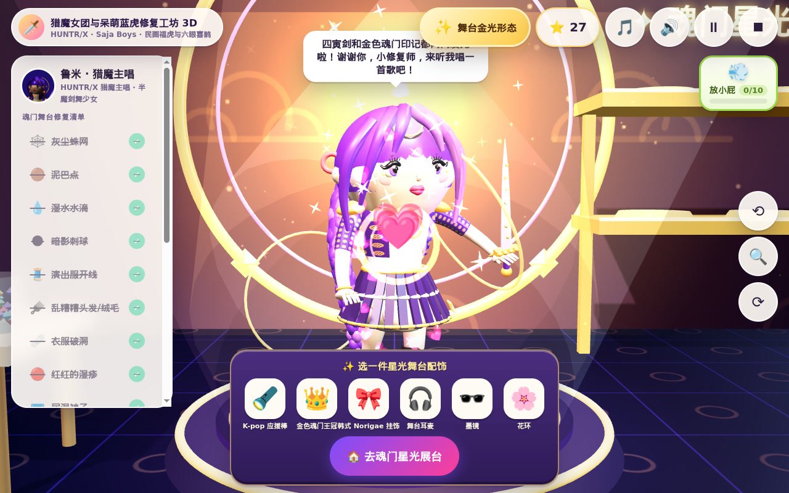

# KPop Demon Hunters Repair Workshop 3D (`猎魔女团与呆萌蓝虎修复工坊 3D`)

**Live Demo (GitHub Pages)**: [https://kunruiw1991.github.io/demon-hunter-repair-workshop/](https://kunruiw1991.github.io/demon-hunter-repair-workshop/)



A standalone, zero-bundler 3D WebGL repair and idol restoration game built with **Three.js r161** (`js/vendor/three.min.js`) for a 5-year-old player. Featuring intricate, high-resolution 3D character models (`34,000–63,600` vertices and `55,000–102,000` triangles per character) of all **10 KPop Demon Hunters characters** — the **3 HUNTR/X Girls**, the **5 Saja Boys**, **Derpy the Blue Minhwa Tiger**, and **Sussie the Six-Eyed Magpie** — complete with an interactive **Stage Idol ↔ Awakened Demon/Spirit Dual Form Toggle**, a 16-tool 3D repair and K-pop restoration clinic, a floating `0/10` → `🍄 蘑菇云大屁!` 3D Mushroom-Cloud Mega Fart button, bundled `zh-CN-XiaoyiNeural` Mandarin voice lines, and persistent `localStorage` Honmoon Showcase Stage.

---

## ✨ Key Features

### 1. 10 High-Resolution 3D Characters Across 4 Category Filter Tabs
Every character is procedurally sculpted from high-density organic surfaces (`LatheGeometry` profile lofts, Catmull-Rom tube/ribbon skinning, articulated 5-finger hands, sculpted facial anatomy, and sRGB procedural canvas textures for K-pop satin weave, Korean gold brocade embroidery, woven horsehair *Gat*, cobalt-and-white peony porcelain, and Minhwa folk brush-stroke fur) with `metalness <= 0.22` for vibrant studio lighting:

| Category Tab | ID | Character | Vertices | Triangles | Signature 3D Features & Props |
|---|---|---|---:|---:|---|
| `🎤 HUNTR/X 猎魔女团 (3)` | `rumi` | **鲁米 · 猎魔主唱 (Rumi)** | 36,672 | 55,340 | Half-demon lead vocalist, 26-segment articulated purple dragon-braid curving to boots, iridescent K-pop crop jacket with gold epaulets, pleated skirt, and **Saingeom (`四寅剑`)** four-tiger sword |
| `🎤 HUNTR/X 猎魔女团 (3)` | `mira` | **米拉 · 刀群舞主舞 (Mira)** | 34,465 | 55,828 | Main dancer with twin-swept hot-pink hair strands, asymmetric K-pop corset with gold waist chains, thigh-high boots, and **Gokdo (`曲刀`)** crescent polearm |
| `🎤 HUNTR/X 猎魔女团 (3)` | `zoey` | **佐伊 · 双丸子头忙内 (Zoey)** | 34,392 | 55,256 | Energetic maknae rapper with twin space-buns + fluttering hair ribbons, street-idol bomber jacket, cargo skirt, sneakers, and twin **Shin-kal (`神刀`)** spirit throwing knives with tassels |
| `🕺 Saja Boys 狮男团 (5)` | `jinu` | **振宇 · 狮男团队长 (Jinu)** | 57,407 | 98,124 | Charismatic leader wearing a finely woven translucent black Korean **Gat (`黑笠`)** horsehair hat with beaded *gatkkeun* chin strap, layered *jeogori* robe & stage coat, silver rings, and 4-stringed **Bipa (`琵琶`)** lute |
| `🕺 Saja Boys 狮男团 (5)` | `abby` | **艾比 · 力量主舞 (Abby)** | 55,727 | 95,016 | Athletic main dancer with sculpted two-tone spiky hair, sleeveless stage vest with metallic cross-straps, sculpted torso/arm anatomy, and fingerless dance gloves |
| `🕺 Saja Boys 狮男团 (5)` | `mystery` | **迷斯 · 银发神秘主唱 (Mystery)** | 48,989 | 85,024 | Enigmatic vocalist with layered silver-violet bangs sweeping over his eyes, high-collar embroidered silk stage coat, and glowing spirit stand microphone |
| `🕺 Saja Boys 狮男团 (5)` | `romance` | **罗曼 · 玫瑰花美男 (Romance)** | 52,478 | 87,492 | Wavy rose-pink parted hair, velvet lapel suit with a sculpted 3D rose brooch + floating heart charm, and rose-gold handheld mic |
| `🕺 Saja Boys 狮男团 (5)` | `baby` | **贝比 · 潮流说唱忙内 (Baby)** | 51,531 | 87,832 | Cute maknae in a plush oversized pastel hoodie, knitted cat-ear beanie, chunky high-top sneakers, and sparkling **Soda Pop (`苏打汽水`)** can prop |
| `🐯 民画福虎与喜鹊 (2)` | `derpy_tiger` | **呆萌蓝虎 · 民画福虎 (Derpy Tiger)** | 63,640 | 102,076 | Chubby Korean *Minhwa* (`민화`) blue tiger with cerulean/indigo tufted fur, black folk-art stripe reliefs, golden saucer eyes, wide grin with white fangs & curled pink tongue, pink toe-bean paws, ringed tail, and **Blue-and-White Porcelain Peony Flowerpot (`青花瓷牡丹花盆`)** |
| `🐯 民画福虎与喜鹊 (2)` | `sussie_magpie` | **苏西 · 六眼小喜鹊 (Sussie Magpie)** | 41,947 | 69,936 | Korean folk magpie with layered black, white, and iridescent-blue feathers, **six glowing golden eyes** (three on each side), sculpted beak & talons, and miniature black **Gat (`小黑笠`)** hat |

### 2. Interactive Dual Form Toggle (`✨ 舞台金光形态` ↔ `🔮 猎魔/冥界觉醒形态`)
Switch any character on the turntable between their **Golden Honmoon Stage Idol Look** and their **Awakened Demon-Mark / Underworld Saja / Minhwa Spirit Look** at any time — illuminating Rumi's glowing purple demon veins & horns, the Saja Boys' golden demon-slit eyes & underworld soul-flame crown, and Derpy's golden Minhwa spirit cloud nimbus.

### 3. Full 15+ Problem Repair Clinic & 16 Tools
Each visit rolls randomized problems visible as 3D decals/meshes on the character and as clickable chips in `#chips` (clicking any chip smoothly rotates the 3D turntable so the problem spot faces the camera):
- **Mud Splatters (`泥巴点`)** → **Bubble Sponge (`🧽 泡泡海绵`)** followed by **Warm Dryer (`💨 吹风机`)** on wet water drops (`湿水水滴`)
- **Dust & Cobwebs (`灰尘蛛网`)** → **Soft Brush (`🧹 软毛刷`)**
- **Thorny Dark-Energy Burrs (`暗影刺球`)** → **Precision Tweezers (`🥢 小镊子`)**
- **Torn Stage Outfit Seams (`演出服开线`)** → **Gold-Thread Needle (`🪡 金线缝衣针`, 4 stitches)**
- **Frizzy Hair Braids / Tangled Fur (`乱糟糟头发/绒毛`)** → **Idol Styling Comb (`🪮 顺发造型梳`)**
- **Torn Costume Patch (`衣服破洞`)** → **Embroidered Crest Patch (`🩹 刺绣补丁`, 3 presses)**
- **Red Bumpy Eczema Rash (`🔴 红红的湿疹`)** → **Soothing Moisture Cream (`🧴 保湿霜`)**
- **Wet Pants (`🩲 尿湿裤子`)** → **Cozy 3D White Diaper (`🩲 小尿布`)** (cleans the wet stain and attaches a tailored 3D white diaper mesh with waistband, front pad, leg cuffs, and side fastener tabs onto the character's pelvis)
- **Cracked Demon-Mark / Honmoon Seal (`🔮 猎魔印记裂纹`)** → **Golden Honmoon Balm (`✨ 魂门金印膏`)** (seals glowing purple cracks into a shimmering golden Honmoon crest)
- **Unraveled Dragon Braid / Loose Gat Hat (`🎀 散乱长辫与黑笠`)** → **Gold-Thread Needle (`🪡 金线缝衣针`)**
- **Dull Weapon / Prop / Tipped Flowerpot (`🗡️ 暗淡法器 / 🪴 翻倒花盆`)** → **Polishing Cloth (`🧤 宝石抛光布`)** (polishes Rumi's Saingeom, Mira's Gokdo, Zoey's Shin-kal, Jinu's Bipa, Baby's Soda Pop, or rights Derpy Tiger's tipped porcelain peony flowerpot with blooming peonies!)
- **Missing Stage Ear-Monitor / Eye Gem (`🔘 掉落耳返/眼眸宝石`)** → **Gem & Ear-Monitor Replacer (`🔘 闪亮耳返/宝石`)**
- **Flat Plush / Outfit Padding (`☁️ 扁塌填充`)** → **Cloud Cotton (`☁️ 云朵蓬蓬棉`, 4 puffs)**
- **Faded Stage Colors (`🎨 褪色演出服`)** → **Neon Idol Airbrush (`🖌️ 舞台焕彩喷笔`)**
- **3-Point Rhythm Stethoscope Checkup (`🩺 律动听诊器`)** + **Golden Honmoon Wake-Up (`💝 魂门舞台唤醒`)** triggering joyful K-pop choreography and Derpy's blooming peony celebration.

### 4. Floating `0/10` → `🍄 蘑菇云大屁!` 3D Mushroom-Cloud Mega Fart Button
Available throughout repair and dress-up:
- Presses `1..10` emit small 3D green gas puffs, comedic WebAudio fart toots, cute character bounce, and increment the charge bar from `1/10` to `10/10`.
- At `10/10`, the button glows (`🍄 蘑菇云大屁!`), and the **11th press** unleashes a rising 3D mushroom cloud (`stem` column + billowing `cap` dome + expanding ground `shockwave` ring) before resetting to `0/10`.

### 5. Idol Dress-Up, Before/After Photo Card & Persistent Showcase Stage
- Equip 6 K-pop & Korean accessories: **K-pop Lightstick (`🔦 K-pop 应援棒`)**, **Golden Honmoon Crown (`👑 金色魂门王冠`)**, **Korean Norigae Charm (`🎀 韩式 Norigae 挂饰`)**, **Stage Headset (`🎧 舞台耳麦`)**, **Sunglasses (`🕶️ 墨镜`)**, and **Flower Crown (`🌸 花环`)**.
- View and download the **Before/After Idol Photo Card (`修理前 / 修理后 · 魂门星光偶像卡`)** and save repaired characters onto the persistent `localStorage` **Honmoon Showcase Stage (`魂门星光展台`)**.

### 6. Bundled `zh-CN-XiaoyiNeural` Mandarin Voices & K-Pop Fusion Audio
- Pre-generated `zh-CN-XiaoyiNeural` MP3 voice lines (`voices/*.mp3`, indexed in `js/voices/manifest.js`) for every character greeting, tool milestone, eczema healing, diaper fitting, Honmoon sealing, flowerpot restoration, fart giggle, and celebration — working 100% offline across desktop, iPad, and mobile browsers.
- Paired with procedural WebAudio ASMR tool effects and bundled K-pop / Korean fusion background tracks (`music/*.mp3`).

---

## 🚀 Local Development & Automated E2E Verification

### Run Locally
```bash
python3 -m http.server 8080
# Open http://localhost:8080 in any modern browser
```

### Automated Headless Chrome (`gbrowser`) E2E Suite
```bash
# 1. Run 3D Scene-Graph, Vertex/Triangle, Metalness, Dual Form & Voice Asset Audit
python3 tests/audit_scene.py

# 2. Run Master E2E Suite (Tiers 1–4 across all 10 characters + iPad 1024x768 & Mobile 390x844 layouts)
python3 tests/verify_all.py
```
